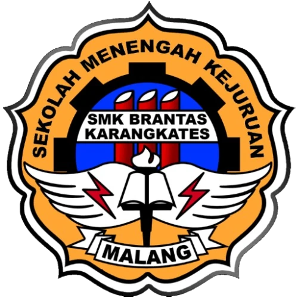

# SMKS Brantas Karangkates

<div align="center">



**Website profil sekolah berbasis HTML dan CSS**

Informasi sekolah, program keahlian, kegiatan, mitra industri, dan kontak resmi dalam satu website sederhana.

</div>

---

## Tentang Project

Website ini dibuat untuk memperkenalkan **SMKS Brantas Karangkates** secara informatif dan mudah dipakai. Struktur halaman menggunakan HTML semantik, layout responsif, dan desain warna biru yang konsisten dengan identitas sekolah.

## Fitur Utama

- Beranda dengan berita, galeri kegiatan, mitra DUDI, dan peta lokasi sekolah.
- Halaman profil berisi sejarah, visi, misi, dan video profil.
- Daftar 9 program keahlian sekolah.
- Halaman kontak dengan definition list, media sosial, dan formulir pertanyaan.
- Navigasi aktif di setiap halaman.
- Tampilan responsif untuk desktop dan mobile.
- Font **Inter** dari Google Fonts.
- Gambar menggunakan format WebP dan atribut `alt`.

## Halaman Website

| Halaman | Isi |
| --- | --- |
| `index.html` | Beranda, berita, galeri, mitra DUDI, dan lokasi sekolah |
| `profile.html` | Profil, sejarah, visi misi, dan video sekolah |
| `jurusan.html` | 9 program keahlian |
| `kontak.html` | Informasi kontak dan formulir pertanyaan |

## Teknologi

- HTML5 semantik
- CSS3
- Flexbox responsive layout
- Google Maps Embed
- Google Fonts
- WebP image assets

## Struktur Folder

```text
.
├── index.html
├── profile.html
├── jurusan.html
├── kontak.html
├── style/
│   └── style.css
└── asset/
    ├── galeri/
    ├── logo.webp
    └── foto-sekolah.webp
```

## Cara Menjalankan

1. Clone atau download repository ini.
2. Buka folder project di Visual Studio Code.
3. Jalankan `index.html` menggunakan browser atau ekstensi Live Server.

Project ini tidak membutuhkan database, framework, atau proses build.

## Catatan Aksesibilitas

- Setiap gambar utama memiliki teks alternatif.
- Navigasi bisa digunakan dengan keyboard.
- Fokus elemen interaktif tetap terlihat.
- Iframe peta memiliki `title` yang deskriptif.
- Layout mobile mencegah konten melebar keluar layar.

## Pengembang

Project tugas website profil sekolah **SMKS Brantas Karangkates**.
